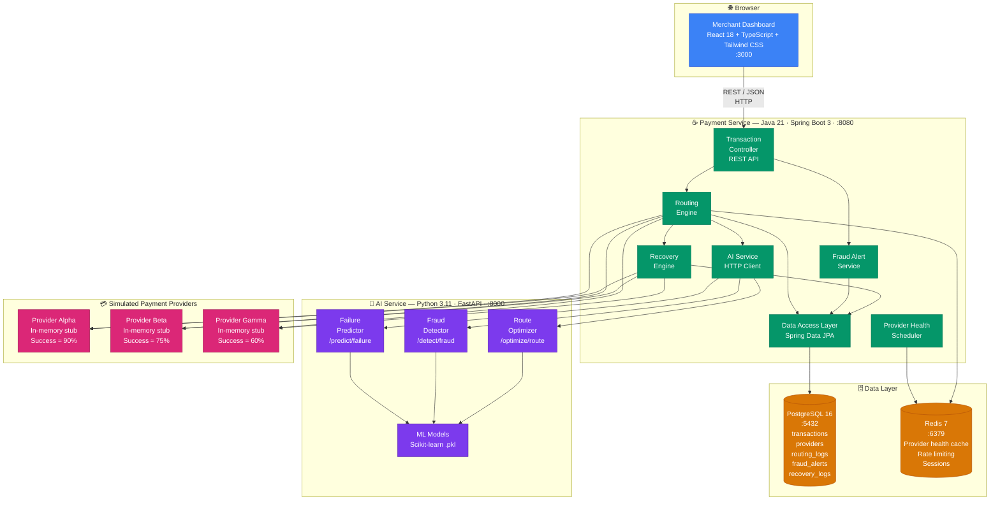
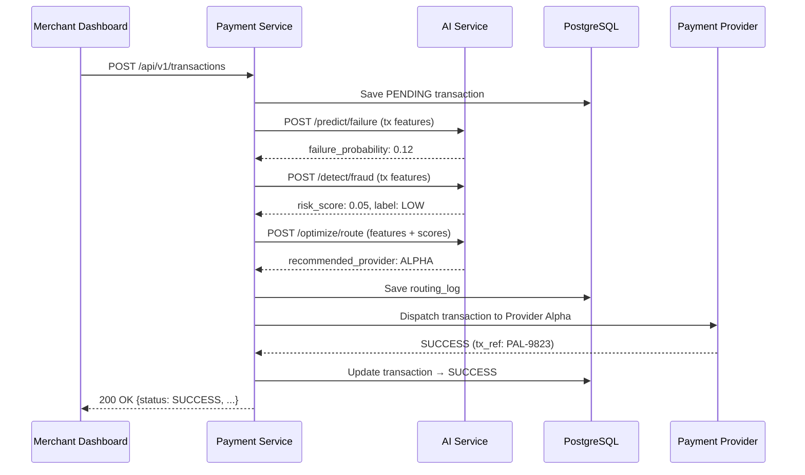
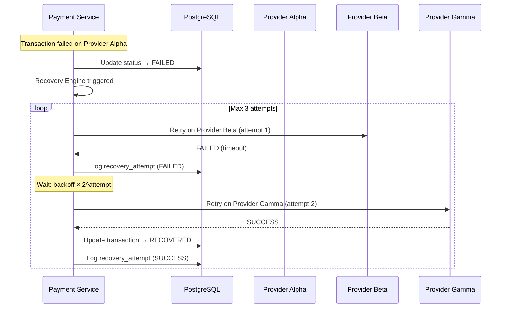

# PayPulse AI — Architecture Diagram

This document contains the Mermaid source for the PayPulse AI system architecture diagram.
Render this in any Mermaid-compatible viewer (GitHub, Mermaid Live Editor, Obsidian, etc.).

---

## System Architecture — Component Overview

---

## Transaction Lifecycle — Sequence Diagram

---

## Recovery Flow — Sequence Diagram

---

## Development Phases — Roadmap

```mermaid
flowchart LR
    P1["Phase 1\n📁 Foundation\nDocs + Structure"] --> P2
    P2["Phase 2\n☕ Backend Core\nSpring Boot + DB"] --> P3
    P3["Phase 3\n🐍 AI Service\nFastAPI + Models"] --> P4
    P4["Phase 4\n⚛️ Frontend\nReact Dashboard"] --> P5
    P5["Phase 5\n🔀 Smart Routing\nProvider selection"] --> P6
    P6["Phase 6\n🔍 Fraud Detection\nAnomaly models"] --> P7
    P7["Phase 7\n🔄 Recovery\nRetry + Failover"] --> P8
    P8["Phase 8\n📡 Kafka Events\nAsync streaming"] --> P9
    P9["Phase 9\n📊 Analytics\nCharts + Reports"] --> P10
    P10["Phase 10\n🚀 Demo Ready\nDocker + Docs"]

    style P1 fill:#22C55E,color:#fff
    style P2 fill:#3B82F6,color:#fff
    style P3 fill:#8B5CF6,color:#fff
    style P4 fill:#06B6D4,color:#fff
    style P5 fill:#F59E0B,color:#fff
    style P6 fill:#EF4444,color:#fff
    style P7 fill:#EC4899,color:#fff
    style P8 fill:#10B981,color:#fff
    style P9 fill:#6366F1,color:#fff
    style P10 fill:#F97316,color:#fff
```

